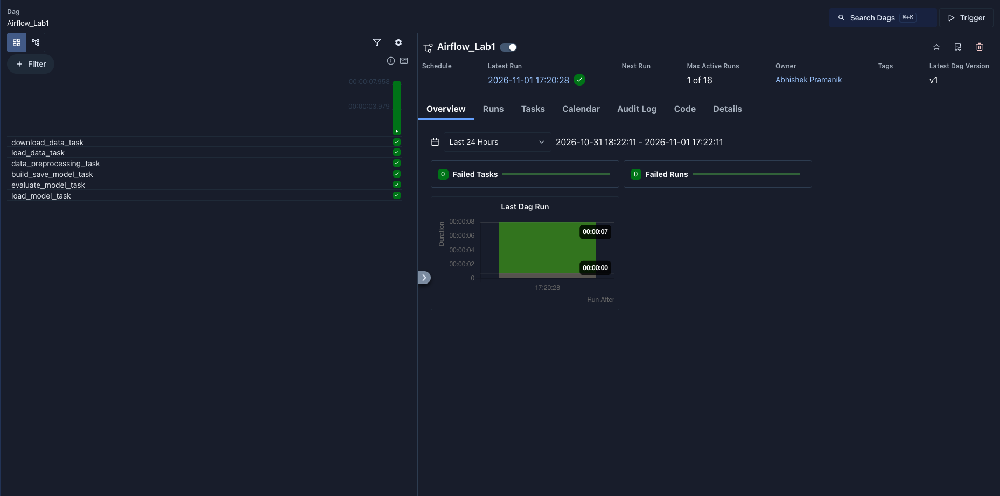
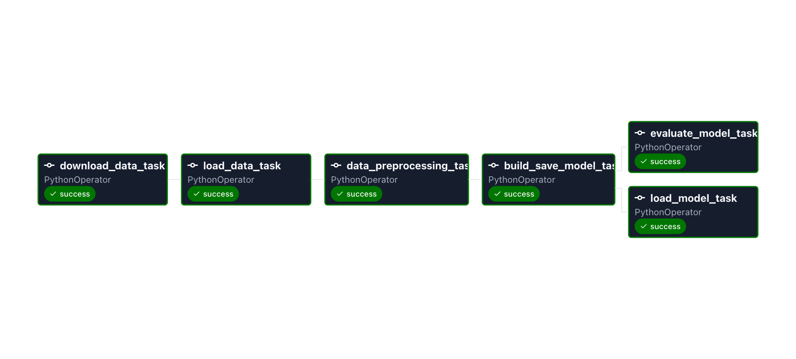
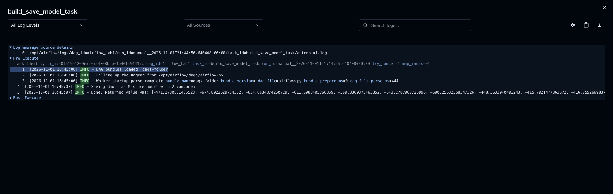
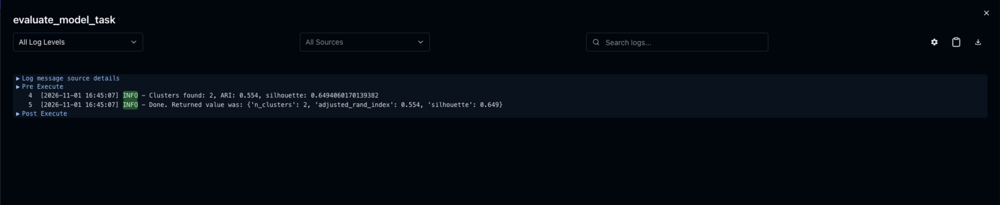

# Airflow Lab 1: Iris Flower Clustering with a Gaussian Mixture Model

## Overview

This lab uses Apache Airflow, running in Docker, to orchestrate a small machine learning pipeline. The pipeline downloads the Iris flower dataset, trains a Gaussian Mixture Model (GMM) that groups flowers into clusters without being told their species, and then evaluates those clusters on flowers the model has never seen.

The data is the classic Iris dataset: 150 flowers from three species (setosa, versicolor and virginica), each with four measurements: sepal length, sepal width, petal length and petal width, all in centimetres. The species labels are not used for training. They are kept only to check, at the end, how well the clusters match the real species.

A Gaussian Mixture Model treats the data as a mix of overlapping bell-shaped clusters, each of which can be stretched or tilted. Unlike K-Means, it gives each flower a probability of belonging to every cluster rather than a single hard label. The number of clusters is chosen with the Bayesian Information Criterion (BIC), which rewards a good fit but penalizes extra clusters.

The pipeline is defined as an Airflow DAG named `Airflow_Lab1` with six tasks. The first four run in sequence; the last two run in parallel once the model is saved:

```
download_data_task >> load_data_task >> data_preprocessing_task >> build_save_model_task >> [load_model_task, evaluate_model_task]
```

| Task | Function | What it does |
|---|---|---|
| `download_data_task` | `download_data()` | Downloads Iris from the UCI Machine Learning Repository (falling back to scikit-learn's bundled copy if the download fails), splits it 80/20 with each species in equal proportion, and saves `data/file.csv` (120 flowers) and `data/test.csv` (30 flowers) |
| `load_data_task` | `load_data()` | Reads `data/file.csv` and passes it on, serialized |
| `data_preprocessing_task` | `data_preprocessing(data)` | Drops missing values, keeps the four measurements, scales them to 0–1 with `MinMaxScaler`, and saves the fitted scaler to `model/scaler.sav` |
| `build_save_model_task` | `build_save_model(data, filename)` | Fits a GMM for every cluster count from 1 to 10, records the BIC for each, and saves the model with the lowest BIC to `model/model.sav` |
| `load_model_task` | `load_model_elbow(filename, bic_scores)` | Loads the saved model and scaler, reports the best number of clusters, and predicts the cluster of the first flower in `data/test.csv` along with its membership probabilities |
| `evaluate_model_task` | `evaluate_model(filename)` | Scores the model on all 30 test flowers with the Adjusted Rand Index (agreement with the true species) and the silhouette score (how well separated the clusters are) |

Tasks pass data to each other through Airflow's XCom. Each payload is pickled and base64-encoded so it can be stored as a plain string. The trained model and scaler are shared through files in `model/`.

## Project structure

```
airflow_lab1/
├── dags/
│   ├── data/
│   │   ├── file.csv        # training data (written by download_data_task)
│   │   └── test.csv        # held-out test flowers (written by download_data_task)
│   ├── model/              # model.sav and scaler.sav are written here
│   ├── src/
│   │   ├── __init__.py
│   │   └── lab.py          # pipeline functions
│   └── airflow.py          # DAG definition
├── images/                 # screenshots used in this README
├── docker-compose.yaml
├── setup.sh                # resets the environment and writes .env
└── README.md
```

The CSV files and the `model/` folder are regenerated on every run.

## Prerequisites

- Docker Desktop, running, with at least 4 GB of memory allocated (8 GB recommended) under Settings → Resources
- Port 8080 free on your machine
- A bash shell to run `setup.sh`: Terminal on Mac or Linux, or WSL / Git Bash on Windows
- The project in a regular local folder, **not** inside OneDrive, iCloud Drive or Dropbox. Docker Desktop cannot mount folders from cloud-synced locations such as `~/Library/CloudStorage/` on macOS, and the containers will fail to start.

No Python packages need to be installed locally. Airflow and the pipeline's dependencies run inside the containers.

## Setup

Run all commands from the project root (the folder containing `dags/`).

**1. Download the Airflow Docker Compose file**

```bash
curl -LfO 'https://airflow.apache.org/docs/apache-airflow/3.3.0/docker-compose.yaml'
```

The DAG uses the Airflow 3 import path `airflow.providers.standard.operators.python`, so it needs an Airflow 3.x Compose file. An older 2.x file will fail to load the DAG.

**2. Edit `docker-compose.yaml`**

In the `environment` section of `x-airflow-common`, hide Airflow's example DAGs and add the pipeline's dependencies:

```yaml
AIRFLOW__CORE__LOAD_EXAMPLES: 'false'
_PIP_ADDITIONAL_REQUIREMENTS: ${_PIP_ADDITIONAL_REQUIREMENTS:-pandas scikit-learn}
```

**3. Run the setup script**

```bash
bash setup.sh
```

The script gives you a clean slate. It stops any previous Airflow containers and deletes their database volume (`docker compose down -v`), recreates the `logs/`, `plugins/` and `config/` folders, writes your user ID into `.env` so files created by Airflow belong to you, and prints Airflow's configuration as a check that the image works. Because it erases the database, re-running it also erases your previous DAG runs.

## Running the pipeline

**1. Initialize the Airflow database** (first run only; takes a few minutes)

```bash
docker compose up airflow-init
```

Wait for `airflow-init-1 exited with code 0`.

**2. Start Airflow**

```bash
docker compose up
```

Leave this terminal running. The first start takes a few minutes because the containers install `pandas` and `scikit-learn`. Airflow is ready when http://localhost:8080 loads.

**3. Open the UI**

Go to http://localhost:8080 and log in with `airflow` / `airflow`.

**4. Trigger the DAG**

Find `Airflow_Lab1` in the DAG list, switch the toggle on, and click ▶ (Trigger).

**5. Stop Airflow when finished**

Press Ctrl+C in the terminal running Airflow, then:

```bash
docker compose down
```

## Validating the results in Airflow

**Check the run succeeded**

Click `Airflow_Lab1` to open its page. The grid shows one column per run and one row per task. A successful run has six green squares; red means a task failed.

**Check the task graph**

Switch to the **Graph** view with the second icon in the top-left corner of the DAG page. You should see the four tasks in a line, then the graph forking into `load_model_task` and `evaluate_model_task`, all with a green border. Click any task, then **Logs**, to see its output.

**Check the download and split**

Open the logs for `download_data_task`:

```
Downloading Iris dataset from https://archive.ics.uci.edu/ml/machine-learning-databases/iris/iris.data
Saved 120 training rows to file.csv and 30 test rows to test.csv (source: UCI repository)
```

If the container has no internet access, the log instead says the download failed and that scikit-learn's bundled copy was used. The pipeline continues either way.

**Check model selection**

Open the logs for `build_save_model_task`:

```
Saving Gaussian Mixture model with 2 components
Done. Returned value was: [-471.278..., -674.802..., -654.683..., ...]
```

The returned value, also shown in the task's **XCom** tab, is the list of 10 BIC scores, one per cluster count. Lower is better:

| Clusters | 1 | 2 | 3 | 4 | 5 | 6 | 7 | 8 | 9 | 10 |
|---|---|---|---|---|---|---|---|---|---|---|
| BIC | −471.3 | **−674.8** | −654.7 | −611.6 | −569.3 | −543.3 | −500.3 | −448.4 | −415.8 | −416.8 |

BIC chooses 2 clusters, not 3, with 3 a close second. This is a well-known result on Iris: setosa is clearly separate, but versicolor and virginica overlap so much that a third cluster does not improve the fit enough to justify its extra parameters.

**Check the prediction**

Open the logs for `load_model_task`:

```
Optimal no. of clusters (lowest BIC): 2
Cluster membership probabilities: [1.0, 0.0]
```

Its XCom `return_value` is the predicted cluster for the first test flower (here `0`, a setosa).

**Check the evaluation**

Open the logs for `evaluate_model_task`:

```
Clusters found: 2, ARI: 0.554, silhouette: 0.6494060170139382
Done. Returned value was: {'n_clusters': 2, 'adjusted_rand_index': 0.554, 'silhouette': 0.649}
```

The Adjusted Rand Index of about 0.55 is moderate because the model found 2 clusters for 3 species: all setosa land in one cluster, and versicolor and virginica share the other. The silhouette score of about 0.65 shows that those 2 clusters are well separated. These scores are measured on the 30 test flowers, which the model never saw during training.

The numbers above come from a run of this pipeline. The UCI file differs from scikit-learn's copy of the dataset in two rows, so results can differ slightly depending on which source `download_data_task` used, and with the scikit-learn version installed in the container.

**Check data passed between tasks**

Click a task → **XCom**. `download_data_task` returns the row counts of the two splits, `build_save_model_task` returns the BIC scores, `load_model_task` returns the predicted cluster and `evaluate_model_task` returns the metrics dictionary. `load_data_task` and `data_preprocessing_task` return long base64 strings, which are the serialized data.

**Check the saved files**

After a successful run, the project folder contains `dags/data/file.csv`, `dags/data/test.csv`, `dags/model/model.sav` and `dags/model/scaler.sav`. The containers write them directly into these folders through the mounted `dags/` directory.

## Screenshots

**DAG run grid**: all six tasks succeeded



**Task graph**: the pipeline forks into prediction and evaluation



**Model selection**: log of `build_save_model_task` with the BIC scores



**Evaluation**: log of `evaluate_model_task`

