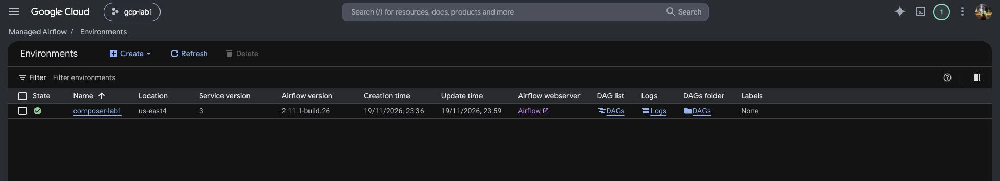
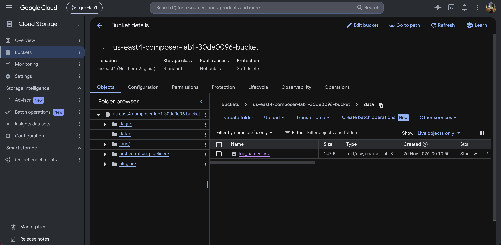

# GCP Cloud Composer Lab 1: Top US Baby Names with BigQuery
 
## Overview
 
This lab uses Google Cloud Composer, Google's managed Apache Airflow service, to orchestrate a small data pipeline on Google BigQuery. The pipeline queries a public BigQuery dataset for the 10 most popular US baby names of the year 2000, saves the results as a CSV in the Composer environment's Cloud Storage bucket, reads the CSV back, and loads the same results into a table in your own BigQuery project.
 
The data is the US baby names public dataset, `bigquery-public-data.usa_names.usa_1910_current`. It was created by the Social Security Administration from Social Security card applications and counts how many babies received each name, by state, sex and year, starting in 1910. To protect privacy, only names with at least 5 occurrences are included. Each row has five columns: `state`, `gender`, `year`, `name` and `number`.
 
The query keeps only births from 2000, adds up `number` across all states and both sexes for each name, and returns the 10 names with the highest totals.
 
The pipeline is defined as an Airflow DAG named `cloud_composer_lab1` with four tasks. After the query, the pipeline forks into two branches that run in parallel:
 
```
query_bigquery >> save_csv >> read_csv
query_bigquery >> save_to_bigquery
```
 
| Task | Function | What it does |
|---|---|---|
| `query_bigquery` | `query_bigquery()` | Runs the SQL query on the public dataset and returns the 10 rows as a list of `(name, total)` pairs |
| `save_csv` | `save_csv(rows)` | Writes the rows to `top_names.csv` in the `data/` folder of the Composer bucket, with a `name,total` header |
| `read_csv` | `read_csv()` | Reads `top_names.csv` back and prints it to the task log |
| `save_to_bigquery` | `save_to_bigquery(rows)` | Creates the dataset `lab1` in your project if it doesn't exist, then loads the rows into the table `lab1.top_names`, replacing any previous contents |
 
The query results are passed from `query_bigquery` to the other tasks through Airflow's XCom. The DAG uses the `@once` schedule with `is_paused_upon_creation=False`, so it runs automatically one time as soon as Composer loads it, and after that only when you trigger it.
 
Composer mounts its bucket on every Airflow worker at `/home/airflow/gcs/`, so the DAG writes to `gs://<bucket>/data/` as if it were a local folder (`/home/airflow/gcs/data/`). The DAG authenticates to BigQuery with the environment's service account, so the code contains no keys or logins.
 
The environment used for this lab:
 
| Setting | Value |
|---|---|
| Name | `composer-lab1` |
| Location | `us-east4` |
| Service version | Composer 3 |
| Airflow version | 2.11.1 |
| Size | Small, standard resilience |
| Service account | `composer-lab1-sa` |
 
## Project structure
 
```
Lab1/
├── airflow_lab1.py     # DAG definition and pipeline tasks
├── images/             # screenshots used in this README
└── README.md
```
 
In the Composer bucket after a run:
 
```
gs://<composer-bucket>/
├── dags/
│   └── airflow_lab1.py   # uploaded DAG
└── data/
    └── top_names.csv     # results (written by save_csv)
```
 
`top_names.csv` and the BigQuery table are regenerated on every run.
 
## Prerequisites
 
- A Google Cloud project with billing enabled. Composer is not part of the BigQuery sandbox; new accounts can use the Google Cloud free trial credit.
- Owner access to the project, or permission to create Composer environments and grant IAM roles
## Setup
 
All commands are run in **Cloud Shell**, so nothing needs to be installed locally.
 
**1. Set the project and enable the APIs**
 
```bash
gcloud config set project your-project-id
gcloud services enable composer.googleapis.com iamcredentials.googleapis.com bigquery.googleapis.com
```
 
**2. Create a service account for the environment**
 
```bash
PROJECT=your-project-id
SA=composer-lab1-sa@$PROJECT.iam.gserviceaccount.com
gcloud iam service-accounts create composer-lab1-sa --display-name="Composer lab service account"
for ROLE in roles/composer.worker roles/bigquery.jobUser roles/bigquery.dataEditor; do
  gcloud projects add-iam-policy-binding $PROJECT --member="serviceAccount:$SA" --role=$ROLE
done
```
 
| Role | Why it's needed |
|---|---|
| Composer Worker | Lets the account run the Composer environment |
| BigQuery Job User | Lets the DAG run query and load jobs |
| BigQuery Data Editor | Lets the DAG create the `lab1` dataset and write the table |
 
**3. Let Composer use the service account**
 
```bash
NUMBER=$(gcloud projects describe $PROJECT --format="value(projectNumber)")
gcloud iam service-accounts add-iam-policy-binding $SA \
  --member="serviceAccount:service-$NUMBER@cloudcomposer-accounts.iam.gserviceaccount.com" \
  --role=roles/composer.ServiceAgentV2Ext
```
 
**4. Create the environment** (takes about 20–30 minutes)
 
```bash
gcloud composer environments create composer-lab1 \
  --location us-east4 \
  --image-version composer-3-airflow-2 \
  --environment-size small \
  --service-account $SA
```
 
**5. Set your project ID in the DAG**
 
In `airflow_lab1.py`, set `PROJECT` to your project ID:
 
```python
PROJECT = "your-project-id"
```
 
## Running the pipeline
 
**1. Upload the DAG**
 
In the Google Cloud console, go to **Composer** and click **DAGs** in the **DAGs folder** column for `composer-lab1`. This opens the `dags/` folder of the environment's bucket. Click **Upload** → **Upload files** and select `airflow_lab1.py`.
 
**2. Open the Airflow UI**
 
Click **Airflow** in the **Airflow webserver** column for `composer-lab1`.
 
**3. Watch the DAG run**
 
Within a few minutes, `cloud_composer_lab1` appears in the DAG list and runs once on its own. To run it again later, click ▶ (Trigger).
 
## Validating the results in Airflow
 
**Check the run succeeded**
 
Click `cloud_composer_lab1` to open its page. The grid shows one column per run and one row per task. A successful run has four green squares; red means a task failed.
 
**Check the task graph**
 
Switch to the **Graph** view. You should see `query_bigquery` on the left, forking into `save_csv` → `read_csv` on one branch and `save_to_bigquery` on the other, all with a green border. Click any task, then **Logs**, to see its output.
 
**Check the query**
 
Click `query_bigquery` → **XCom**. The `return_value` is the list of 10 `[name, total]` pairs, sorted from the most popular name down.
 
**Check the CSV**
 
Open the logs for `save_csv`:
 
```
Saved /home/airflow/gcs/data/top_names.csv
```
 
Then open the logs for `read_csv`, which prints the contents of the file: a `name,total` header followed by the 10 names and their totals.
 
**Check the BigQuery load**
 
Open the logs for `save_to_bigquery`:
 
```
Saved 10 rows to your-project-id.lab1.top_names
```
 
## Validating the results in Google Cloud
 
**Check the CSV in Cloud Storage**
 
Open the environment's DAGs folder, go up one level to the bucket, and open `data/`. `top_names.csv` is there; click it to view or download it.
 
**Check the table in BigQuery**
 
In **BigQuery**, open your project → `lab1` → `top_names` in the **Explorer** panel. The **Schema** tab shows two columns, `name` (STRING) and `total` (INTEGER), and **Preview** shows the 10 rows. You can also query it:
 
```sql
SELECT * FROM `your-project-id.lab1.top_names` ORDER BY total DESC
```
 
The results match `top_names.csv` exactly. This run produced:
 
| Rank | Name | Total |
|---|---|---|
| 1 | Jacob | 34,505 |
| 2 | Michael | 32,096 |
| 3 | Matthew | 28,587 |
| 4 | Joshua | 27,553 |
| 5 | Emily | 25,962 |
| 6 | Christopher | 24,957 |
| 7 | Nicholas | 24,657 |
| 8 | Andrew | 23,651 |
| 9 | Hannah | 23,085 |
| 10 | Joseph | 22,840 |
 
Emily and Hannah are the only girls' names in the top 10. The totals are slightly lower than the SSA's national figures because the dataset leaves out names with fewer than 5 babies in a given state.
 
**Check the jobs**
 
Open **Job history** → **Project history**. Each run of the DAG adds two jobs, run by `composer-lab1-sa`: a query job from `query_bigquery` and a load job from `save_to_bigquery`.
 
## Cleanup
 
Composer bills for every hour the environment exists, even when no DAGs are running, so delete it once.
 
**1. Delete the environment** (takes several minutes)
 
```bash
gcloud composer environments delete composer-lab1 --location us-east4
```
 
**2. Delete the bucket**
 
Deleting the environment does not delete its bucket. In **Cloud Storage** → **Buckets**, delete the bucket whose name starts with `us-east4-composer-lab1`.
 
 
## Notes
 
- `@once` only runs automatically the first time Composer sees the DAG. Use ▶ (Trigger) for every run after that.
- If `query_bigquery` or `save_to_bigquery` fails with a permission error, check that `composer-lab1-sa` has the BigQuery Job User and BigQuery Data Editor roles. IAM changes can take a few minutes to apply, and each task retries once after 2 minutes.
- New DAG files can take a few minutes to appear in the Airflow UI after upload.
## Screenshots
 
**Composer environment**: `composer-lab1` running in `us-east4` on Composer 3 with Airflow 2.11.1, with links to its Airflow UI, DAG list, logs and DAGs folder
 

 
**DAG run graph**: all four tasks succeeded
 

 
**Query results**: XCom of `query_bigquery`
 

 
**CSV in Cloud Storage**: `top_names.csv` (147 B) written by `save_csv` to the `data/` folder of the environment's bucket, `us-east4-composer-lab1-30de0096-bucket`
 

 
**BigQuery table**: preview of `gcp-lab1-514817.lab1.top_names`, loaded by `save_to_bigquery`, showing the 10 most popular names of 2000
 

 