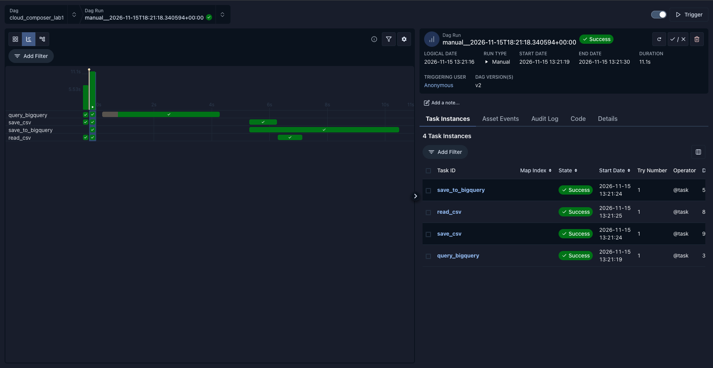
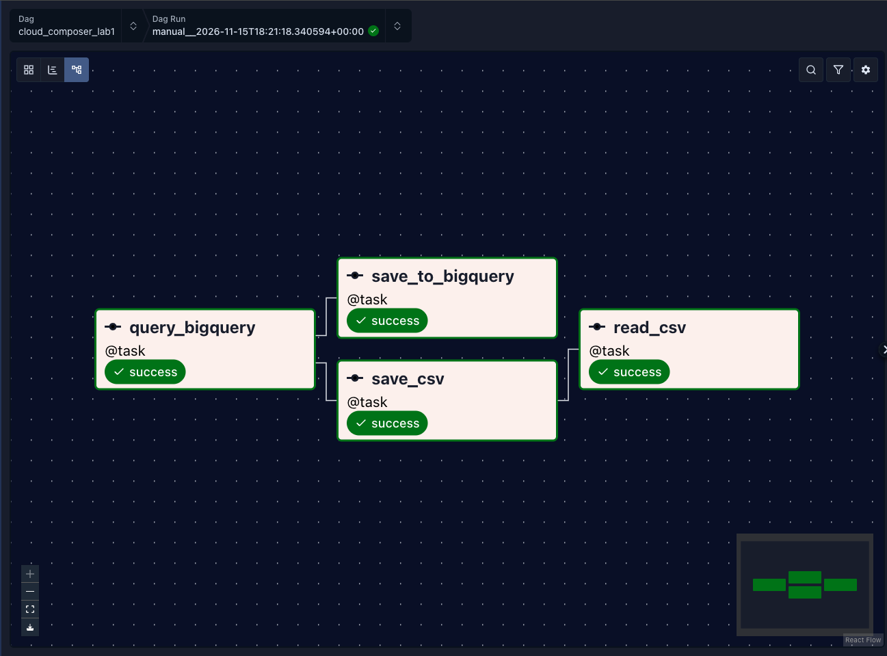
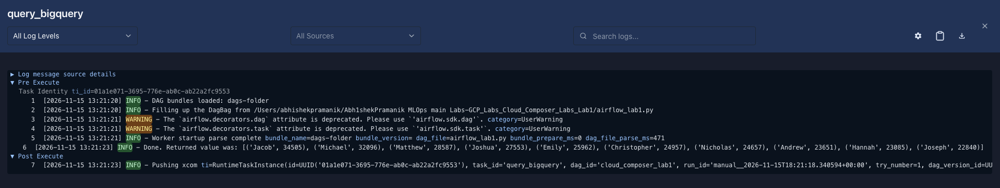
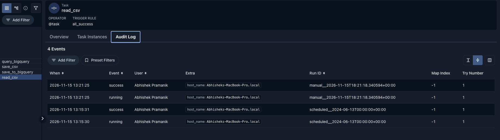
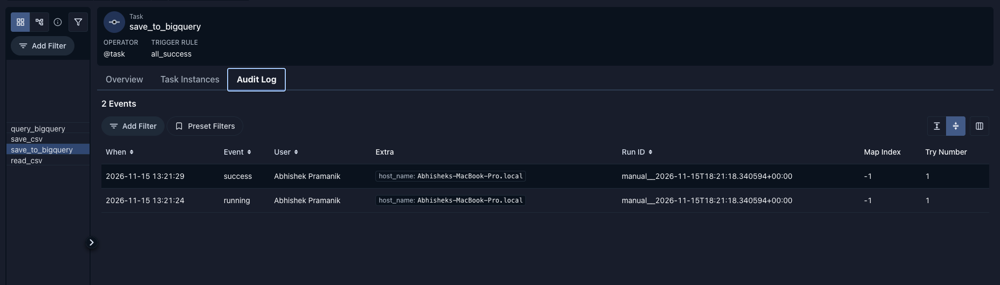
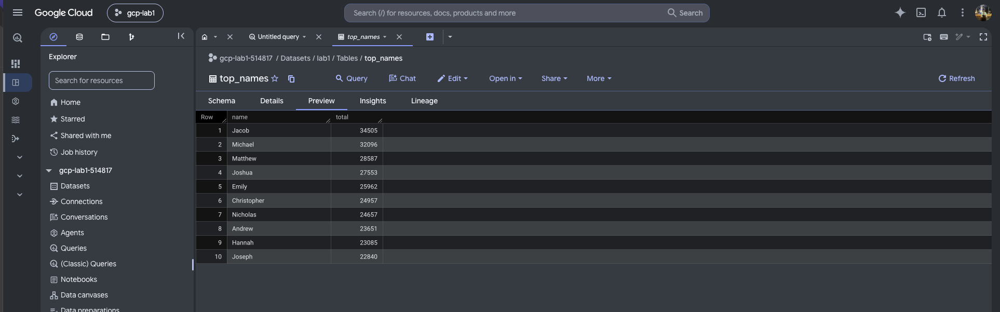

# GCP CLoud Composer Lab 1: Top US Baby Names with BigQuery

## Overview

This lab uses Apache Airflow, running locally on your own computer, to orchestrate a small data pipeline on Google BigQuery. The pipeline queries a public BigQuery dataset for the 10 most popular US baby names of the year 2000, saves the results as a CSV in the lab folder, reads the CSV back, and loads the same results into a table in your own BigQuery project.

The data is the US baby names public dataset, `bigquery-public-data.usa_names.usa_1910_current`. It was created by the Social Security Administration from Social Security card applications and counts how many babies received each name, by state, sex and year, starting in 1910. To protect privacy, only names with at least 5 occurrences are included. Each row has five columns: `state`, `gender`, `year`, `name` and `number`.

The query keeps only births from 2000, adds up `number` across all states and both sexes for each name, and returns the 10 names with the highest totals.

Everything runs for free. Airflow runs on local machine, and BigQuery is used through the BigQuery sandbox.

The pipeline is defined as an Airflow DAG named `cloud_composer_lab1` with four tasks. After the query, the pipeline forks into two branches that run in parallel:

```
query_bigquery >> save_csv >> read_csv
query_bigquery >> save_to_bigquery
```

| Task | Function | What it does |
|---|---|---|
| `query_bigquery` | `query_bigquery()` | Runs the SQL query on the public dataset and returns the 10 rows as a list of `(name, total)` pairs |
| `save_csv` | `save_csv(rows)` | Writes the rows to `top_names.csv` in the lab folder, with a `name,total` header |
| `read_csv` | `read_csv()` | Reads `top_names.csv` back and prints it to the task log |
| `save_to_bigquery` | `save_to_bigquery(rows)` | Creates the dataset `lab1` in your project if it doesn't exist, then loads the rows into the table `lab1.top_names`, replacing any previous contents |

The query results are passed from `query_bigquery` to the other tasks through Airflow's XCom. The DAG uses the `@once` schedule with `is_paused_upon_creation=False`, so it runs automatically one time as soon as Airflow finds it, and after that only when you trigger it.

## Project structure

```
Lab1/
├── airflow_lab1.py     # DAG definition and pipeline tasks
├── top_names.csv       # results 
├── .airflowignore      # tells Airflow to skip the venv
├── images/             # screenshots used in this README
└── README.md
```

`top_names.csv` and the BigQuery table are regenerated on every run.

## Prerequisites

- A Python virtual environment with Airflow 3.x and the BigQuery client library installed. This lab uses one called `airflow-venv`. To create one:
  ```bash
  python3 -m venv airflow-venv
  source airflow-venv/bin/activate
  pip install apache-airflow google-cloud-bigquery
  ```
- The Google Cloud CLI (`gcloud`), installed from cloud.google.com/sdk
- A Google account with a BigQuery sandbox project
- Port 8080 free on your machine
- Mac or Linux. On Windows, run everything inside WSL.

## Setup

Run all commands from the lab folder (the folder containing `airflow_lab1.py`).

**1. Create a BigQuery sandbox project**

Go to console.cloud.google.com/bigquery, sign in with your Google account and create a project when prompted. Copy the project ID from the project picker at the top of the page.

**2. Set your project ID in the DAG**

In `airflow_lab1.py`, set `PROJECT` to your project ID:

```python
PROJECT = "your-project-id"
```

**3. Let your computer access BigQuery**

```bash
gcloud auth application-default login
```

Sign in with the same Google account that owns the project. This only needs to be done once per computer.

**4. Skip the venv when loading DAGs** (only if `airflow-venv` is inside the lab folder)

```bash
echo "airflow-venv" > .airflowignore
```

Without this, Airflow tries to load every Python file inside the venv as a DAG and shows a long list of import errors.

## Running the pipeline

**1. Start Airflow**

```bash
source airflow-venv/bin/activate
export AIRFLOW__CORE__LOAD_EXAMPLES=False
export AIRFLOW__CORE__DAGS_FOLDER="$(pwd)"
export AIRFLOW__CORE__SIMPLE_AUTH_MANAGER_ALL_ADMINS=True
airflow standalone
```

The first line activates the venv. The `export` lines hide Airflow's example DAGs, point Airflow at the lab folder, and turn off the login screen, which is safe because Airflow only runs on your computer. Leave this terminal running. The first start takes a minute while Airflow sets up its database.

**2. Open the UI**

Go to http://localhost:8080.

**3. Watch the DAG run**

Within a minute or so, `cloud_composer_lab1` appears in the DAG list and runs once on its own. To run it again later, click ▶ (Trigger).

**4. Stop Airflow when finished**

Press Ctrl+C in the terminal running Airflow.

## Validating the results in Airflow

**Check the run succeeded**

Click `cloud_composer_lab1` to open its page. The grid shows one column per run and one row per task. A successful run has four green squares; red means a task failed.

**Check the task graph**

Switch to the **Graph** view. You should see `query_bigquery` on the left, forking into `save_csv` → `read_csv` on one branch and `save_to_bigquery` on the other, all with a green border. Click any task, then **Logs**, to see its output.

**Check the query**

Click `query_bigquery` → **XCom**. The `return_value` is the list of 10 `[name, total]` pairs, sorted from the most popular name down.

**Check the CSV**

Open the logs for `save_csv`. It prints the full path of the file it wrote:

```
Saved /path/to/Lab1/top_names.csv
```

Then open the logs for `read_csv`, which prints the contents of the file: a `name,total` header followed by the 10 names and their totals.

**Check the BigQuery load**

Open the logs for `save_to_bigquery`:

```
Saved 10 rows to your-project-id.lab1.top_names
```

## Validating the results in BigQuery

Go to console.cloud.google.com/bigquery with your project selected.

**Check the table**

In the **Explorer** panel, open your project → `lab1` → `top_names`. The **Schema** tab shows two columns, `name` (STRING) and `total` (INTEGER), and **Preview** shows the 10 rows. You can also query it:

```sql
SELECT * FROM `your-project-id.lab1.top_names` ORDER BY total DESC
```

The results should match `top_names.csv` exactly.

**Check the jobs**

Open **Job history** → **Personal history**. Each run of the DAG adds two jobs: a query job from `query_bigquery` and a load job from `save_to_bigquery`.

## Notes

- Because the project uses the BigQuery sandbox, the `top_names` table is deleted automatically after 60 days. The next run recreates it.
- `@once` only runs automatically the first time Airflow sees the DAG. Use ▶ (Trigger) for every run after that.
- If `query_bigquery` or `save_to_bigquery` fails, check that `PROJECT` matches your project ID and that `gcloud auth application-default login` used the account that owns it.

## Screenshots

**DAG run grid**: all four tasks succeeded



**Task graph**: the pipeline forks into the CSV branch and the BigQuery branch



**Query results**: XCom of `query_bigquery`



**CSV contents**: log of `read_csv`



**BigQuery load**: log of `save_to_bigquery`



**BigQuery table**: preview of `lab1.top_names` in the console

